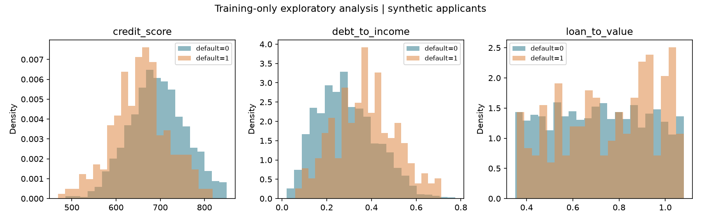
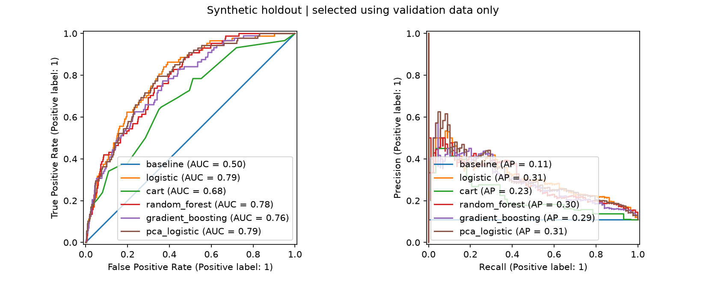
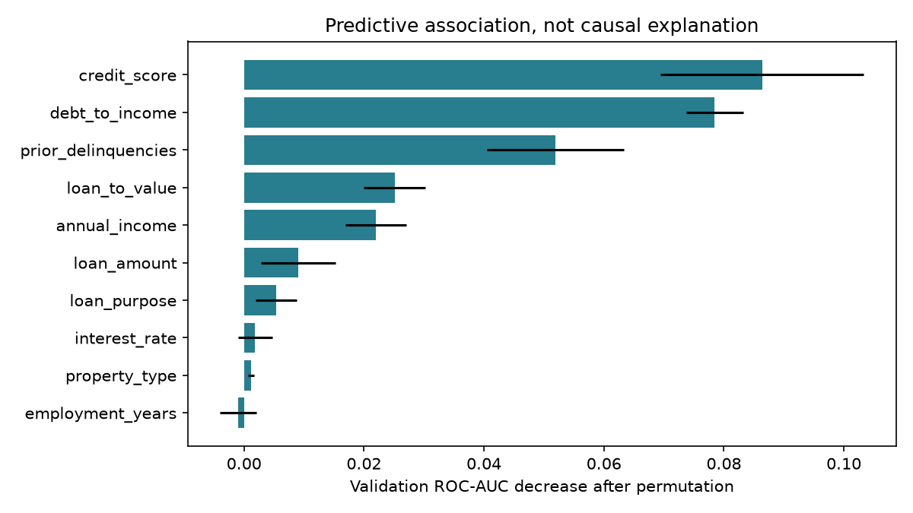
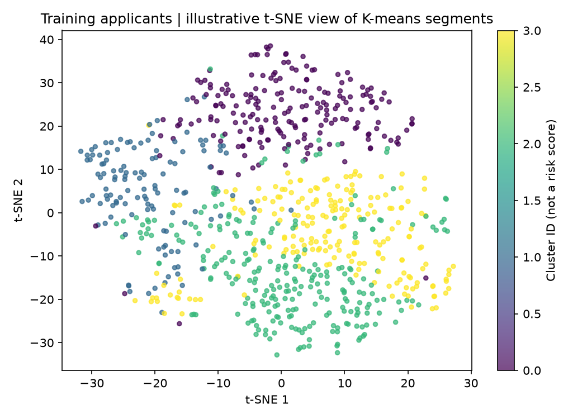

# MortgageRiskLab

A complete, reproducible mortgage-default classification workflow connecting **AI/ML, Finance, and Risk Management**.

**Data disclosure:** this is a newly implemented portfolio demonstration using fictional, generated applicants. It is not a release of historical project materials, private borrower records, employer data, or coursework. Results measure performance on a synthetic process and do not establish real-world credit performance.

## Workflow

Synthetic applications → exploratory analysis → stratified train/validation/test split → imputation, encoding and scaling → model comparison → validation-based model and threshold selection → frozen holdout evaluation → segmentation and prediction.

### Methods

- Median numeric and most-frequent categorical imputation, one-hot encoding, standardization.
- Prior-probability baseline, logistic regression, CART, random forest, gradient boosting, and PCA + logistic regression.
- ROC-AUC, PR-AUC (average precision), Brier score, precision, recall, F1, and confusion matrices.
- An illustrative 5:1 false-negative/false-positive cost for validation threshold selection.
- Validation permutation importance and training-only K-means segmentation with t-SNE visualization.

Logistic regression is used for a binary default outcome. RMSE and ordinary linear regression are not the primary tools for this classification task.

## Run the full project

Python 3.11 or newer:

```sh
python -m venv .venv
# Windows: .venv\Scripts\activate
# macOS/Linux: source .venv/bin/activate
python -m pip install -e .
python -m mortgage_risk.cli train --rows 4000 --seed 42 --output reports
python -m unittest discover -s tests -v
```

This generates a fitted pipeline (`reports/model.joblib`), a machine-readable model comparison (`reports/metrics.json`), evaluation curves, feature importance, and a segmentation chart. Model artifacts are intentionally excluded from Git; regenerate them locally. Only load trusted joblib artifacts.

Score the included fictional examples:

```sh
python -m mortgage_risk.cli predict --model reports/model.joblib --input examples/sample_applications.csv --output predictions.csv
```

The result contains a simulated default probability and a review flag. The review flag is a demonstration of a threshold policy, not a lending recommendation.

## Results

See [measured synthetic results](reports/RESULTS.md), [metrics](reports/metrics.json), and [methodology](docs/METHODOLOGY.md).









## Repository structure

```text
mortgage_risk/data.py       Synthetic data generation and input schema
mortgage_risk/modeling.py   Preprocessing, estimators, evaluation and threshold policy
mortgage_risk/cli.py        Training, plots, segmentation, persistence and prediction
tests/                     Pipeline correctness and leakage checks
examples/                  Fictional sample applications
docs/                      Data dictionary, methodology and model boundaries
reports/                   Actual generated evaluation outputs
```


Real deployment would require lawful data access, a defined default horizon, temporal/out-of-time validation, calibration and stability checks, fairness assessment, explainability review, model governance, security controls, and monitoring.
